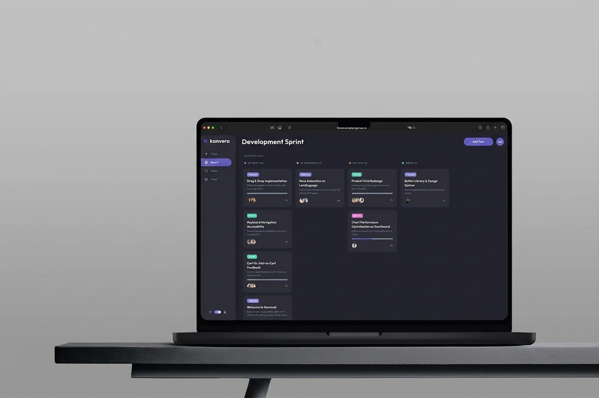
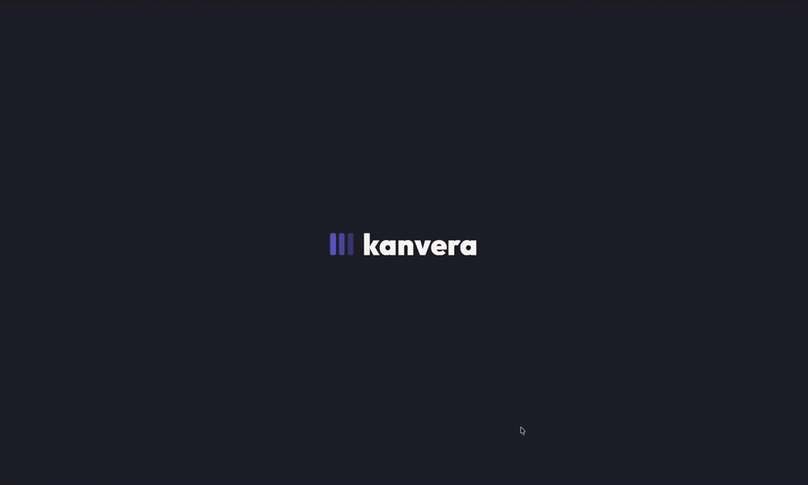

<div align="center">

# KANVERA

**Plan, organize and execute work in one place: Board, Inbox, Team and Pulse.**

Vanilla JavaScript · ES6 Modules · Firebase Realtime Database · CSS

[Live demo](https://stefanstraeter.github.io/kanvera/) · [Report a bug](https://github.com/stefanstraeter/kanvera/issues)

<br />



</div>

---

## About

Kanvera is a project management app built without a framework. Tasks move across a Kanban board, personal work lands in the Inbox, the team is managed in one directory and Pulse shows how the day is going.

It started as a training project at the Developer Akademie and shows how far plain JavaScript gets you with a clean modular structure: feature folders, a central state and shared components.

---

## Highlights

- **Kanban board** – Drag and drop on desktop, a modal action sheet to move tasks on touch devices.
- **Task details** – Inline editing, subtasks, assignees and priority controls in one modal.
- **Personal Inbox** – A filterable list of the tasks assigned to you.
- **Pulse dashboard** – Overview metrics and a time-based greeting.
- **Team management** – Add, edit and delete members.
- **Auth flow** – Sign in, sign up, guest access and route guarding.
- **Light and dark theme** – Token-based colors, the preference is remembered.
- **Tactile feedback** – Toasts everywhere, `navigator.vibrate` on mobile.
- **Resilient storage** – Works even where Web Storage is blocked, for example Safari Private Mode.



---

## Tech Stack

- **Vanilla JavaScript** with ES6 Modules
- **HTML5** with shared fragments in `templates/`
- **CSS3** with a layered structure and theme variables
- **Firebase Realtime Database** as the data backend
- **Web Storage APIs** with safe fallbacks

---

## Getting Started

```bash
git clone https://github.com/stefanstraeter/kanvera.git && cd kanvera
# serve the folder with any local server, e.g. VS Code Live Server
# then open index.html to start the auth flow
```

There is no build step and no dependency to install.

<details>
<summary><strong>Main views</strong></summary>

<br />

| Page         | View                                               |
| ------------ | -------------------------------------------------- |
| `board.html` | Task pipeline: Up Next, In Progress, Review, Done  |
| `inbox.html` | Personal task list focused on assigned work        |
| `team.html`  | Member directory and profile management            |
| `pulse.html` | KPI-style overview and daily momentum              |
| `index.html` | Entry point with sign in, sign up and guest access |

</details>

<details>
<summary><strong>Project structure</strong></summary>

<br />

```text
src/
├── core/                 # State initialization, Firebase access, global data flow
├── features/             # One folder per domain
│   ├── auth/
│   ├── board/
│   ├── inbox/
│   ├── member/
│   ├── pulse/
│   ├── task/
│   └── team/
└── shared/
    ├── components/       # Header, Navbar, Modal
    └── utils/            # Theme, validation, UI helpers, constants
styles/                   # Layered CSS: core, features, shared
templates/                # Static HTML fragments for layout composition
```

Every feature is split into focused files (`*.manager.js`, `*.service.js`, `*.template.js`) with clear responsibilities. A single app entry initializes only the managers the active page needs.

</details>

---

## Under the hood

- **Multi-page, shared logic** – Header, sidebar, theme and auth guard are shared across standalone HTML pages.
- **State and cache** – A central in-memory state with a synchronized session cache and change notifications.
- **Two ways to move a task** – Drag and drop on desktop, tap-first modal on mobile, because native touch drag is unreliable.
- **Storage that never breaks the app** – Safe fallbacks for restricted browser environments.
- **One design language** – A token-based color system across pages, components and feedback.

---

## Good to know

This is a demo. The Firebase database is open and the sign-in is not a real security layer. Do not use it as is for sensitive data.

---

## Author

**Stefan Sträter** · [github.com/stefanstraeter](https://github.com/stefanstraeter/)
